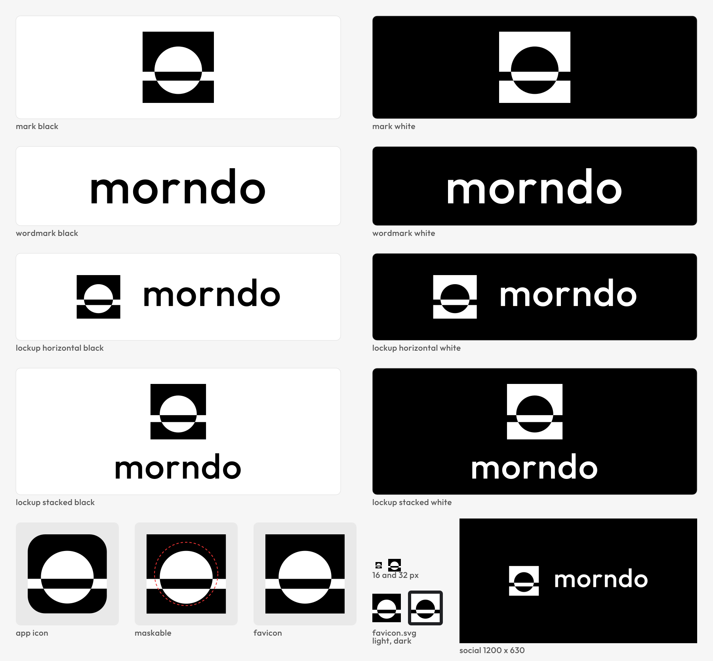

# Morndo brand: how to use it

**The mark is called Horizon.** It shows the whole sun on the horizon, and the line flips inside it: done by morning.

## The pieces

| Piece | Use it for | Files (`assets/`) |
|---|---|---|
| Mark | Avatars, small spaces, anywhere the name is already shown | `mark/morndo-mark-{black,white,currentcolor}.svg`, plus 512 px PNGs |
| Wordmark | Text-only placements | `wordmark/morndo-wordmark-{black,white,currentcolor}.svg` |
| Horizontal lockup | The default logo: headers, documents, slides | `lockup-horizontal/…svg`, plus 256 px-high PNGs |
| Stacked lockup | Square or narrow spaces, splash screens | `lockup-stacked/…svg`, plus 512 px-high PNGs |
| App icon | Launchers and stores: the block is the rounded tile | `app-icon/morndo-app-icon.svg` and its 1024 PNG. The maskable version is full-bleed. |
| Web set | Browser tab, home screen, PWA | `web/`: copy the folder into the web root and paste `head.html` |
| Social image | Link previews (Open Graph), 1200 × 630 | `social/morndo-og-1200x630.{svg,png}` |

## Colour: black and white only

- **Black and white only:** `#000000` and `#FFFFFF`. There are no greys, tints, gradients or accent colours.
- **Pick by background:** the black version goes on light backgrounds, the white version on dark ones.
- **`currentColor` versions** take the text colour around them, so they theme with the UI. That colour must still be black or white.
- **UI colours** (backgrounds, text, status) are design tokens. See [COLOR.md](COLOR.md).

## Clear space

**X is the sun's radius,** one third of the mark's side (16 units on the 48-unit grid).

Keep at least X clear on every side of the mark, the wordmark and both lockups. No text, edge or other logo goes inside that space.

## Minimum size

| Piece | Screen | Print |
|---|---|---|
| Mark | 16 px | 6 mm |
| Horizontal lockup | 20 px high (wordmark x-height about 8 px) | 8 mm high |
| Stacked lockup | 48 px high | 15 mm high |

**What 16 px looks like:** the horizon band lands on exactly 2 whole pixels (grid y 27 to 33, which is pixels 9 and 10), and the sun still reads. Below 16 px the line closes up. At 16 px the mark can also read as Θ or a no-entry sign, so use the horizontal lockup wherever there is room.

## Do

- Use the files as delivered, and scale them proportionally.
- Use the white version on dark or busy backgrounds, and keep the contrast high.
- Use the rounded app icon for launchers and stores, the maskable icon for Android, and the `web/` set for browsers.

## Don't

- Recolour it, or add shadows, outlines, glows or textures.
- Rotate, skew, stretch or flip it.
- Move or resize the sun, or shorten the horizon. The line runs the full width of the block.
- Retype "morndo" in another font, change its spacing or capitalise it.
- Put the mark inside another shape (a circle, a badge), or crop it.
- Set it below the minimum sizes, or let anything into the clear space.

## The wordmark font

- **Font:** "morndo" is set in **Outfit**, weight 500, with +2% tracking, then turned into outlines.
- **Licence:** Outfit is by The Outfit Project Authors, under the **SIL Open Font License 1.1**, with no Reserved Font Name. The licence text is in `source/fonts/OFL.txt`.
- **Font file:** `source/fonts/Outfit[wght].ttf` is the unmodified upstream file (`github.com/google/fonts`, `ofl/outfit`). It is only there so the outlines can be regenerated; the shipped assets contain outlines only.

## Look-alike note

| Mark checked | Closeness | Note |
|---|---|---|
| **London Underground roundel** (TfL's "bar and circle", a registered trade mark since 1917 per tfl.gov.uk): a circle crossed by a bar that runs past it | **3/5, medium** | The closest existing mark. |
| Konica Minolta's globe mark | 2-3/5 | |
| Θ, and a no-entry sign | | Readings at 16 px. |

- **Kept by the owner's choice** (2026-10-01), over three refinements (M1a-M1c) that moved away from the roundel.
- **This is a visual screen, not legal clearance.** It was made by ChatGPT through our studio queue, with our own checks of the cited records.
- **Before registering the mark or a public launch,** run a figurative search at EUIPO and USPTO, ideally with a trade-mark attorney:
  - Vienna and design codes 26.01 (circles), 26.04 (squares) and 26.17 (bands and lines);
  - classes 9 and 42.
